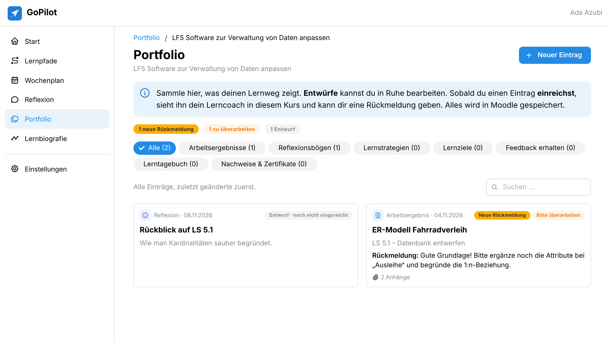
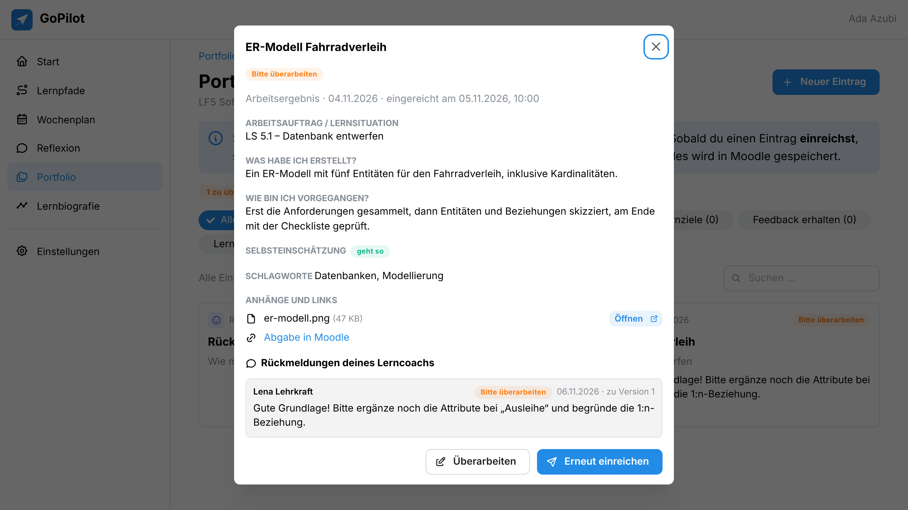
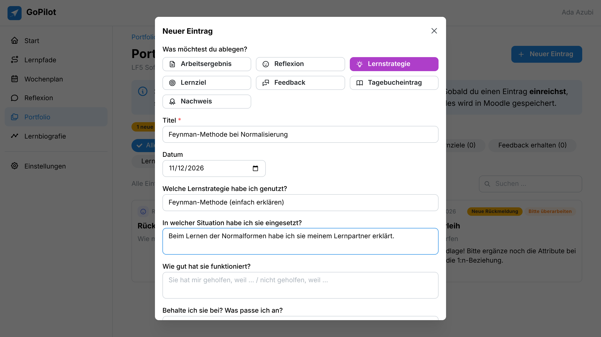
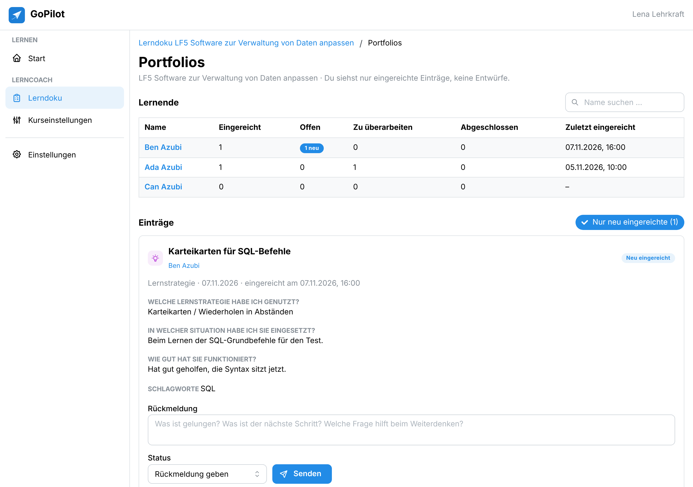
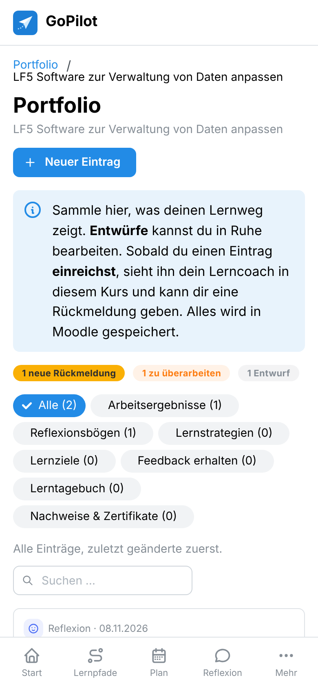
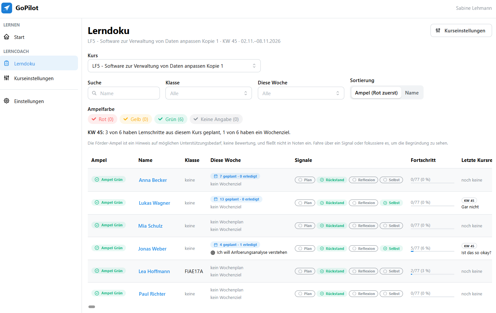
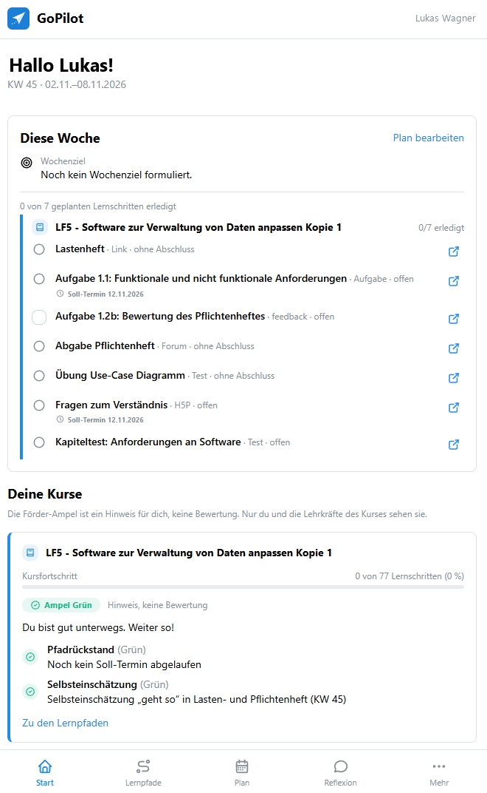

# GoPilot mit Portfolio-Lernmappe

> **Hinweis:** Dieses Repository ist eine Erweiterung von [jtuttas/gopilot](https://github.com/jtuttas/gopilot) (Jörg Tuttas). Es enthält GoPilot vollständig und zusätzlich die **Portfolio-Lernmappe** (Plugin-Version 0.7.0). Lizenz wie im Original: GNU GPL v3 oder später (siehe Dateiköpfe im Plugin).
>
> **Idee und Konzept der Portfolio-Lernmappe:** [Herr-FR](https://github.com/Herr-FR)

## Was die Portfolio-Lernmappe ergänzt

- **Lernende** führen pro Kurs eine Mappe mit sieben Registern: Arbeitsergebnisse, Reflexionsbögen, Lernstrategien, Lernziele, Feedback erhalten, Lerntagebuch, Nachweise & Zertifikate. Jeder Eintrag hat Leitfragen, eine Selbsteinschätzung, Anhänge und Links. Einträge sind zuerst Entwurf und werden durch **Einreichen** für den Lerncoach sichtbar.
- **Lerncoaches** sehen in der Lerndoku unter **Portfolios** die eingereichten Einträge und geben eine Rückmeldung mit Status: Rückmeldung, bitte überarbeiten oder abgeschlossen.
- **Verbindung zum [MMBbS Teaching Assistant](https://github.com/Herr-FR/Gopilot_teaching-assistent)**: Im Check-in und Check-out am Beamer zeigt der Teaching Assistant einen QR-Code, der bei den Lernenden einen vorausgefüllten Portfolio-Eintrag öffnet (Lernstrategie des Tages bzw. Lerntagebuch mit den Check-out-Fragen). Beide Werkzeuge nutzen dieselbe Liste von Lernstrategien. Lehrkräfte finden den Teaching Assistant im Menü unter **Unterrichtsassistent**. Die Werkzeuge bleiben getrennt: Der Teaching Assistant speichert weiterhin nichts auf einem Server.
- **Alles liegt in Moodle**: Einträge und Rückmeldungen in eigenen Plugin-Tabellen, Anhänge im Moodle-Dateisystem, mit Datenschutz-Export und -Löschung.

### Download

**[release/local_gopilot-0.7.0.zip](release/local_gopilot-0.7.0.zip)**: das Moodle-Plugin `local_gopilot` 0.7.0 mit der Portfolio-Lernmappe als fertiges ZIP. Installation in Moodle unter **Website-Administration → Plugins → Plugin installieren** (ZIP hochladen) oder durch Entpacken nach `local/gopilot`. Ein vorhandenes GoPilot 0.6.0 wird dabei auf 0.7.0 aktualisiert, die bisherigen Daten bleiben erhalten. Die App wird wie in [docs/installation.md](docs/installation.md) beschrieben gebaut, weil beim Bauen die Moodle-Adresse eingetragen wird.

### Mitwirkende

| Person | Beitrag |
|---|---|
| [Herr-FR](https://github.com/Herr-FR) | Idee und Konzept der Portfolio-Lernmappe |
| [Jörg Tuttas](https://github.com/jtuttas) | GoPilot (App und Moodle-Plugin), auf dem die Erweiterung aufbaut |
| Claude (Anthropic) | Umsetzung der Erweiterung nach Vorgabe von Herr-FR |

### Einblick

**Lernende: die Mappe eines Kurses.** Register mit Zählern, Status jedes Eintrags (Entwurf, eingereicht, bitte überarbeiten …) und neue Rückmeldungen auf einen Blick.



**Lernende: ein Eintrag mit Rückmeldung.** Antworten auf die Leitfragen, Selbsteinschätzung, Anhänge aus Moodle, Links und die Rückmeldung des Lerncoachs. Bei „Bitte überarbeiten“ kann der Eintrag geändert und erneut eingereicht werden.



**Lernende: neuer Eintrag.** Erst wählen, was abgelegt wird, dann die passenden Leitfragen beantworten. Für Lernstrategien gibt es Vorschläge.



**Lerncoach: Portfolios eines Kurses.** Alle Lernenden mit offenen, zu überarbeitenden und abgeschlossenen Einträgen, darunter die neu eingereichten Einträge mit Rückmeldung und Status.



**Auf dem Handy.**



Die Namen in den Bildern sind erfunden (Demo-Modus der App).

**Ausprobieren:** Die App läuft unter https://herr-fr.github.io/GoPilot_Plugin_Portfolio-Lernmappe/ und ist mit dem Moodle unter `https://service.joerg-tuttas.de/moodle` verbunden; angemeldet wird mit einem Konto dieses Moodle. Die Portfolio-Lernmappe funktioniert dort erst, wenn auf dem Moodle das Plugin ab Version 0.7.0 installiert ist. Eine andere Moodle-Adresse setzt die Repository-Variable `MOODLE_URL`, der Wert `demo` schaltet auf den Demo-Modus mit Beispieldaten (Anmeldung als `ada` oder `lena`, beliebiges Kennwort).

Details: [API-Vertrag, Abschnitt Portfolio](docs/api-v1.md), [ADR 0009](docs/adr/0009-portfolio-im-plugin.md), [Anleitung](docs/anleitung/app-gopilot.md). Das Plugin wird wie im Original installiert ([docs/installation.md](docs/installation.md)); ein bestehendes GoPilot 0.6.0 wird per Moodle-Upgrade auf 0.7.0 aktualisiert.

---

# GoPilot

Frontend für Moodle, das das selbstgesteuerte Lernen von Auszubildenden an berufsbildenden Schulen fördert. Inspiriert von scobees.

- Fachlicher Kontext und Glossar: [CONTEXT.md](CONTEXT.md)
- Architekturentscheidungen: [docs/adr/](docs/adr/)
- Umsetzungsplan: [docs/umsetzungsplan-v1.md](docs/umsetzungsplan-v1.md)
- Anleitung für Lehrkräfte und Moodle-Administration: [docs/anleitung/lehrkraefte-moodle.md](docs/anleitung/lehrkraefte-moodle.md)
- Anleitung zur App für Auszubildende und Lehrkräfte: [docs/anleitung/app-gopilot.md](docs/anleitung/app-gopilot.md) (auch als PDF)
- Installation auf einem Moodle-System: [docs/installation.md](docs/installation.md) (auch als PDF)

## Einblick

**Lehrkraft: Lerndoku.** Alle Lernenden eines Kurses auf einen Blick, mit Förder-Ampel, Wochenplan, Wochenziel, Signalen und Fortschritt.



**Lernende: Startseite.** Der Plan der Woche mit den Lernschritten aus Moodle, darunter die eigenen Kurse mit Fortschritt und Ampel.



Die Namen in den Bildern sind erfunden.

## Aufbau

```
plugin/local_gopilot/   Moodle-Plugin (PHP): Daten, Webservices, Ampel, Push
app/                    PWA (React + TypeScript + Vite)
deploy/dev/             Lokale Moodle-Entwicklungsumgebung (moodle-docker)
```

## Lokale Entwicklung

Voraussetzungen: Git, Docker Desktop, Node.js 22 oder neuer, eine Bash (unter Windows: Git Bash).

### Moodle starten

```bash
deploy/dev/setup.sh
```

```bash
deploy/dev/start.sh
```

`setup.sh` holt einmalig moodle-docker und Moodle 4.5 LTS nach `.dev/`. `start.sh` startet die Container, installiert Moodle beim ersten Mal und legt Testdaten an:

- Kurse `GOPILOT-LF5` (zwei Lernsituationen) und `GOPILOT-LF8` (eine Lernsituation), mit Soll-Terminen rund um die aktuelle Woche
- Lehrkraft `lehrkraft1` und Azubis `azubi1` bis `azubi3` mit unterschiedlichen Lernständen

Die Zugangsdaten der Testkonten stehen in [deploy/dev/seed.php](deploy/dev/seed.php). Moodle läuft danach auf http://localhost:8000.

Der Moodle-Code liegt im Docker-Volume `gopilot_moodlecode`, weil Dateizugriffe auf das Windows-Laufwerk Moodle stark ausbremsen. `start.sh` kopiert ihn beim ersten Start aus `.dev/moodle` hinein. Das Plugin ist dagegen direkt aus `plugin/local_gopilot` eingehängt. Nach einer Änderung an `version.php` übernimmt ein erneuter Aufruf von `start.sh` das Upgrade.

```bash
deploy/dev/stop.sh
```

`stop.sh --reset` löscht zusätzlich Datenbank und Moodle-Daten.

### App starten

```bash
cd app && npm install && npm run dev
```

Die App läuft auf http://localhost:5173 und spricht Moodle über `VITE_MOODLE_URL` aus `app/.env.development` an. Moodle erlaubt den Zugriff von fremden Ursprüngen an `login/token.php` und `webservice/rest/server.php` selbst (ADR 0007). Anmelden kannst du dich mit den Testkonten aus `deploy/dev/seed.php`.

Ohne Moodle geht es mit Beispieldaten im Browser:

```bash
cd app && npm run dev:mock
```

Im Mock-Modus melden sich `ada`, `ben` und `can` (Lernende mit grüner, gelber und roter Ampel) sowie `lena` (Lehrkraft) mit beliebigem Kennwort an.

Push-Benachrichtigungen funktionieren nur in der gebauten App (`npm run build && npm run preview`), weil der Dev-Server keinen Service Worker aktiviert.

### Schnittstelle

Plugin und App halten sich an den API-Vertrag in [docs/api-v1.md](docs/api-v1.md). Änderungen an Webservices dort zuerst eintragen.

## GitHub Pages

Der Workflow [.github/workflows/pages.yml](.github/workflows/pages.yml) baut die App bei jedem Push auf `main`, der `app/` ändert, und veröffentlicht sie unter https://herr-fr.github.io/GoPilot_Plugin_Portfolio-Lernmappe/ (im Original: https://jtuttas.github.io/gopilot/). Beim ersten Lauf schaltet der Workflow GitHub Pages selbst ein. In diesem Repository ist `https://service.joerg-tuttas.de/moodle` als Moodle voreingestellt; die Repository-Variable `MOODLE_URL` überschreibt das (`demo` = Demo-Modus). Manuell starten geht über **Actions → App auf GitHub Pages → Run workflow**.

- **Ohne weitere Einstellung** läuft die App dort im **Demo-Modus** mit Beispieldaten (Anmeldung mit `ada`, `ben`, `can` oder `lena` und beliebigem Kennwort).
- **Mit echtem Moodle:** unter **Settings → Secrets and variables → Actions → Variables** die Repository-Variable `MOODLE_URL` anlegen, z. B. `https://moodle.schule.de`, und den Workflow neu starten. Das Moodle muss per HTTPS aus dem Internet erreichbar sein und wie in [docs/installation.md](docs/installation.md) eingerichtet sein; ein lokales Test-Moodle auf `localhost` funktioniert von GitHub Pages aus nicht.

## Betrieb

Die vollständige Schritt-für-Schritt-Anleitung steht in [docs/installation.md](docs/installation.md) (auch als PDF): Voraussetzungen, Plugin installieren, Moodle einrichten, App bauen und ausliefern (nginx/Apache), Prüfung, Fehlersuche, Update und Deinstallation. Kurzfassung:

- **Moodle:** ab Version 4.2. Plugin nach `local/gopilot` kopieren, Upgrade ausführen, dann die Einrichtung aus dem Administrationsteil der [Anleitung](docs/anleitung/lehrkraefte-moodle.md) vornehmen. Für Web-Push einmalig VAPID-Schlüssel erzeugen: `php local/gopilot/cli/generate_vapid.php`. Unter **Website-Administration → Plugins → Lokale Plugins → GoPilot** die Adresse der App (`appurl`) eintragen, damit Moodle-Nachrichten auf die App verlinken.
- **App:** `npm run build` erzeugt statische Dateien in `app/dist/`. `VITE_MOODLE_URL` beim Build auf die Moodle-Adresse setzen. Auf der App-Domain ist HTTPS nötig, und der Webserver muss unbekannte Pfade an `index.html` weitergeben (SPA-Fallback, bei nginx `try_files $uri /index.html;`), damit Links aus Benachrichtigungen wie `/woche/2026-11-02` funktionieren.

### Tests

```bash
cd app && npm run lint && npm test && npm run build
```

Plugin-Tests (PHPUnit, Code-Checker) laufen in der CI über `moodle-plugin-ci`, siehe [.github/workflows/ci.yml](.github/workflows/ci.yml).
