# GoPilot benutzen

Anleitung zur App GoPilot: Teil A für Auszubildende, Teil B für Lehrkräfte.

GoPilot hilft dabei, das eigene Lernen in Moodle selbst zu steuern. Du planst deine Woche, arbeitest Lernschritte ab, schaust am Ende zurück und bekommst Rückmeldung von deiner Lehrkraft. Alle Lerninhalte kommen aus Moodle. GoPilot ist die Schicht darüber, die Planung, Reflexion und Coaching zusammenbringt.

Die Screenshots zeigen die Testumgebung mit den Kursen „LF5 Software zur Verwaltung von Daten anpassen“ und „LF8 Daten systemübergreifend bereitstellen“.

## Die wichtigsten Begriffe

| Begriff | Bedeutung |
|---|---|
| **Lernpfad** | eine Lernsituation, in Moodle ein Kursabschnitt |
| **Lernschritt** | eine Aktivität im Lernpfad, z. B. eine Seite oder eine Abgabe |
| **Soll-Termin** | bis wann ein Lernschritt erledigt sein sollte |
| **Wochenplan** | deine Auswahl an Lernschritten für eine Woche, dazu dein **Wochenziel** |
| **Reflexion** | dein Rückblick auf die Woche: allgemein und pro Kurs, mit **Selbsteinschätzung** |
| **Coaching-Feedback** | Rückmeldung deiner Lehrkraft zu deiner Kursreflexion; du kannst antworten |
| **Förder-Ampel** | Hinweis, ob in einem Kurs Unterstützung sinnvoll sein könnte, keine Bewertung |
| **Portfolio** | deine Mappe pro Kurs: Arbeitsergebnisse, Reflexionen, Lernstrategien, Lernziele, Feedback, Lerntagebuch und Nachweise |

---

# Teil A: Für Auszubildende

## Anmelden

Öffne GoPilot im Browser deines Handys oder Rechners. Melde dich mit **denselben Zugangsdaten wie in Moodle** an.

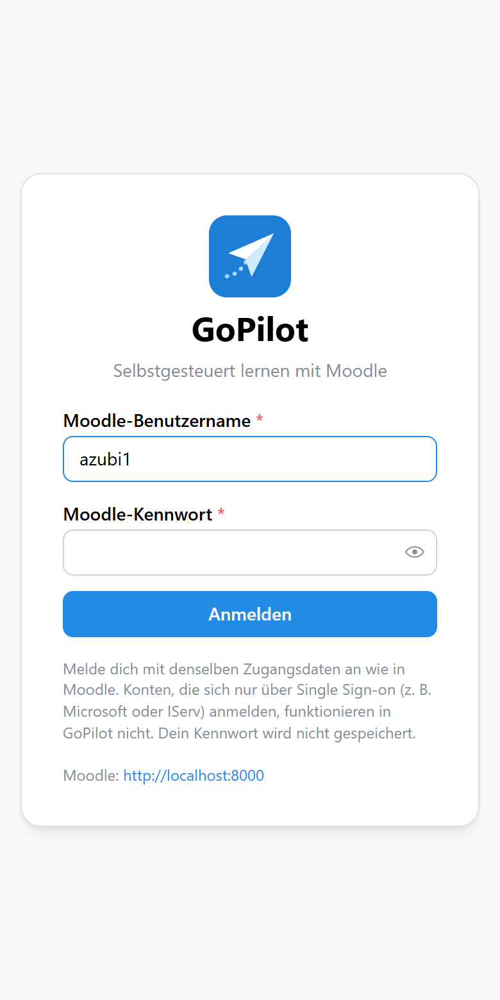

Dein Kennwort wird nicht gespeichert, GoPilot merkt sich nur einen Zugangsschlüssel. Konten, die sich in Moodle nur über Single Sign-on anmelden (z. B. über Microsoft oder IServ), funktionieren in GoPilot nicht. Dann brauchst du ein Moodle-Kennwort.

Unten auf dem Handy findest du die Navigation: **Start**, **Lernpfade**, **Plan**, **Reflexion** und **Mehr**.

## Start: deine Woche auf einen Blick

Die Startseite zeigt die laufende Kalenderwoche mit deinem Wochenziel und den geplanten Lernschritten. Die Lernschritte sind nach Kurs gruppiert: Jeder Kurs hat eine eigene Farbe, die du auch im Wochenplan und bei **Deine Kurse** wiederfindest.

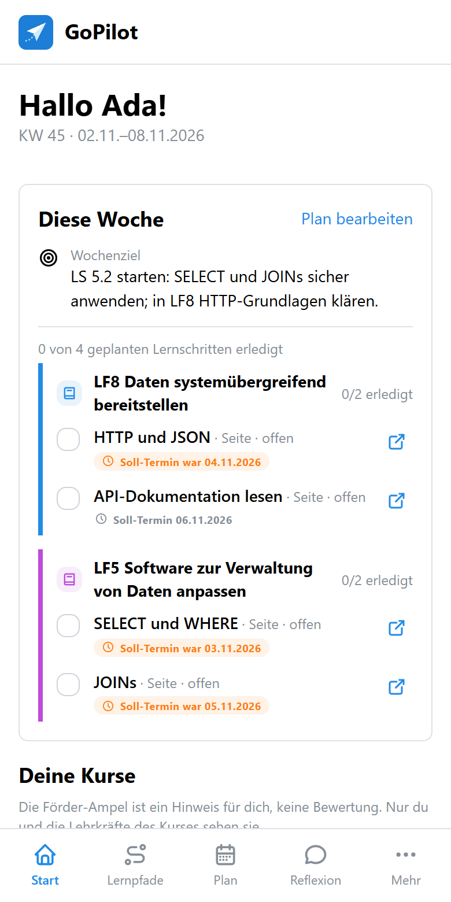

- **Abhaken:** Lernschritte, die du selbst als erledigt markieren darfst, hakst du direkt hier ab. Das landet auch in Moodle. Abgaben und Tests setzt Moodle automatisch auf erledigt, sobald die Bedingung erfüllt ist.
- **In Moodle öffnen:** Das Pfeil-Symbol rechts öffnet die Aktivität in Moodle in einem neuen Tab. Du wirst dabei automatisch in Moodle angemeldet und musst dein Kennwort nicht noch einmal eingeben.
- Hat dir eine Lehrkraft geschrieben, steht die Nachricht ganz oben, bis du sie gelesen hast (siehe [Coaching-Feedback](#coaching-feedback)).
- Hast du noch nichts geplant, erscheint oben der Hinweis **Woche planen**. Ab Freitag erinnert dich GoPilot ans **Reflektieren**.

Weiter unten stehen **Deine Kurse** mit Kursfortschritt und Förder-Ampel:

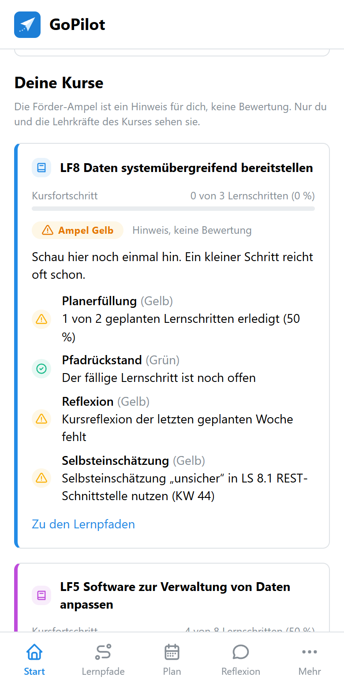

### Die Förder-Ampel verstehen

Die Ampel ist ein **Hinweis für dich, keine Note**. Nur du und die Lehrkräfte des Kurses sehen sie, Vergleiche mit anderen gibt es nicht. Sie setzt sich aus vier Signalen zusammen, und bei jedem steht, warum es so ist:

| Signal | Worum es geht | Standard-Grenzen |
|---|---|---|
| **Planerfüllung** | Wie viele deiner geplanten Lernschritte hast du letzte Woche geschafft? | grün ab 70 %, gelb ab 40 %, darunter rot |
| **Pfadrückstand** | Wie viele Lernschritte sind über ihren Soll-Termin hinaus noch offen? Die Begründung nennt auch, wie viele schon fällig waren, z. B. „3 von 7 fälligen Lernschritten noch offen“. | 0–1 grün, 2–3 gelb, ab 4 rot |
| **Reflexion** | Hast du die Wochen reflektiert, für die du etwas aus dem Kurs geplant hattest? | 1 fehlende Woche gelb, 2 in Folge rot |
| **Selbsteinschätzung** | Wie sicher hast du dich zuletzt eingeschätzt? | „unsicher“ gelb, „komme nicht klar“ rot |

Die Ampel zeigt immer das schlechteste Signal. Ein grauer Kreis bedeutet, dass ein Signal gerade nicht ausgewertet wird, z. B. wenn du letzte Woche nichts aus diesem Kurs geplant hattest. Deine Lehrkraft kann die Grenzen für ihren Kurs anpassen.

## Lernpfade

Unter **Lernpfade** wählst du einen Kurs und siehst seine Lernsituationen mit Fortschritt. Ein Lernpfad lässt sich aufklappen und zeigt dann seine Lernschritte:

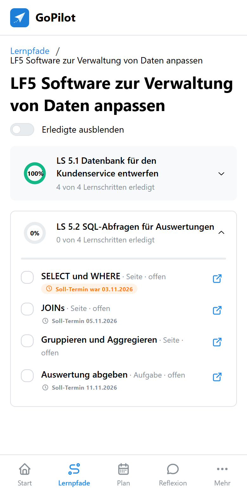

- Bei jedem Lernschritt steht der **Soll-Termin**. Ist er schon vorbei und der Schritt noch offen, ist er orange markiert („Soll-Termin war …“).
- Mit **Erledigte ausblenden** blendest du fertige Schritte aus.

## Woche planen

Unter **Plan** legst du fest, was du dir für **diese** oder die **nächste Woche** vornimmst.

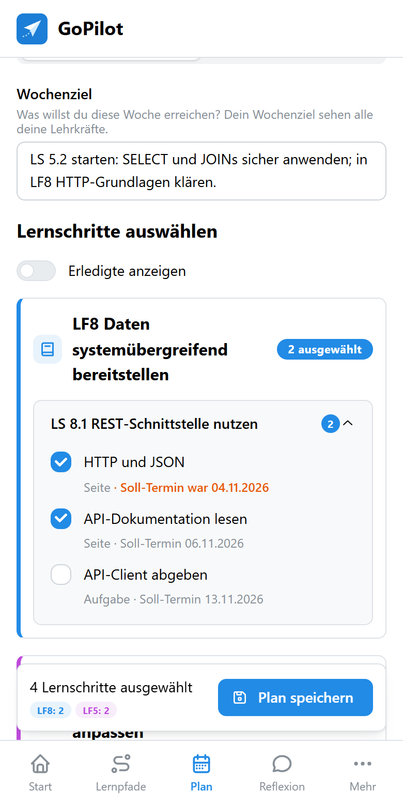

1. **Wochenziel formulieren:** Was willst du in dieser Woche erreichen? Dein Wochenziel sehen alle deine Lehrkräfte.
2. **Lernschritte auswählen:** Jeder Kurs steht in einem eigenen Kasten mit Kursfarbe und Kursname, darin die Lernpfade. Oben rechts im Kasten siehst du, wie viele Schritte du aus diesem Kurs ausgewählt hast. Bereits erledigte Schritte sind ausgeblendet, über **Erledigte anzeigen** holst du sie zurück.
3. **Plan speichern:** Die Leiste unten zeigt, wie viele Schritte du ausgewählt hast, bei mehreren Kursen auch je Kurs (z. B. „LF5: 2“).

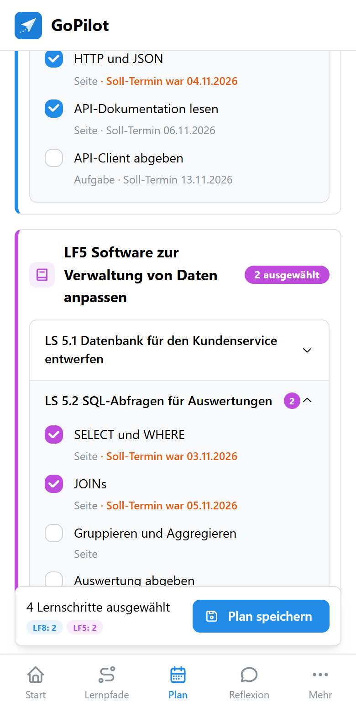

Tipps:

- Plane lieber weniger und schaffe es.
- Wenn du einen Kurs in einer Woche einplanst, reflektiere ihn am Ende der Woche. Freitags erinnert dich GoPilot daran.
- Wochen ohne Plan, z. B. Ferien, zählen nicht für die Ampel.
- Vergangene Wochen lassen sich nicht mehr umplanen.

## Woche reflektieren

Unter **Reflexion** schaust du auf **diese** oder die **letzte Woche** zurück. Ältere Wochen kannst du nur noch lesen.

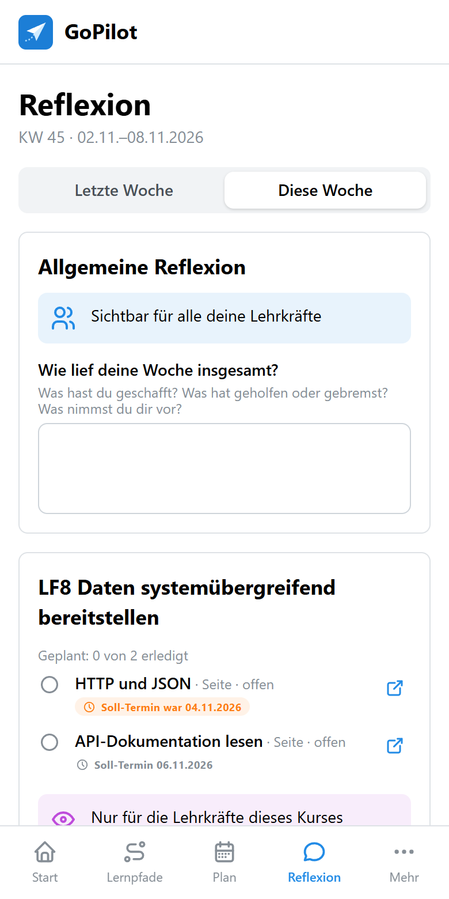

Die Reflexion hat zwei Teile, die **unterschiedlich sichtbar** sind:

- **Allgemeine Reflexion** (blauer Hinweis): Wie lief deine Woche insgesamt? Das sehen **alle deine Lehrkräfte**.
- **Kursreflexion** (lila Hinweis): Wie bist du in diesem Kurs vorangekommen? Das sehen **nur die Lehrkräfte dieses Kurses**.

Für jeden Lernpfad, aus dem du Schritte geplant hattest, gibst du eine **Selbsteinschätzung** ab: *sicher*, *geht so*, *unsicher* oder *komme nicht klar*, auf Wunsch mit Kommentar. Ehrlich sein lohnt sich: Gerade „unsicher“ und „komme nicht klar“ sind für deine Lehrkraft das Signal, auf dich zuzugehen.

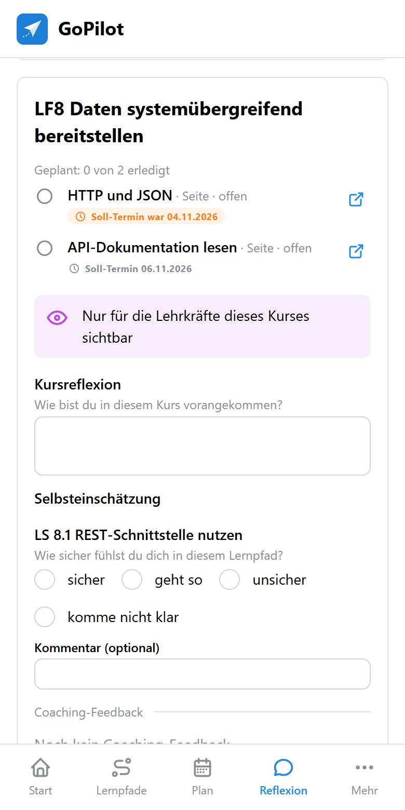

Am Ende speicherst du mit **Reflexion speichern**. Deine Lehrkräfte werden benachrichtigt.

### Coaching-Feedback

Unter jeder Kursreflexion steht der Gesprächsfaden mit deiner Lehrkraft. Antworten kannst du direkt darunter, auch in älteren Wochen.

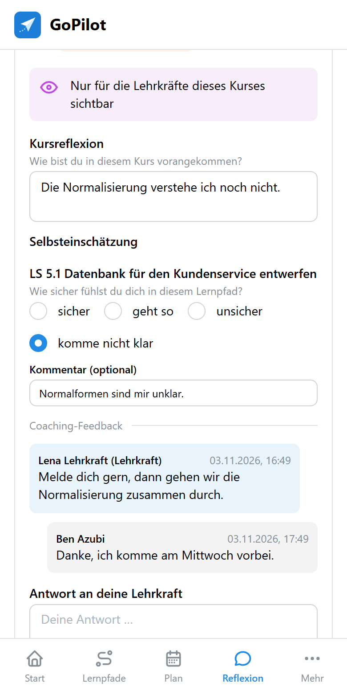

Kommt neues Feedback, bekommst du eine Benachrichtigung, als Push oder in Moodle. Außerdem steht die Nachricht ganz oben auf der Startseite, bis du sie gelesen hast: Mit **Antworten** öffnest du die Reflexion der Woche mit dem Faden, mit **Gelesen** blendest du sie aus. Sobald du den Faden öffnest, gilt das Feedback ebenfalls als gelesen.

## Portfolio

Unter **Portfolio** (auf dem Handy unter **Mehr → Portfolio**) führst du pro Kurs eine Mappe. Die Einträge sind nach Registern sortiert: **Arbeitsergebnisse**, **Reflexionsbögen**, **Lernstrategien**, **Lernziele**, **Feedback erhalten**, **Lerntagebuch** und **Nachweise & Zertifikate**.

1. Wähle **Neuer Eintrag** und dann, was du ablegen möchtest.
2. Gib einen Titel ein und beantworte die Leitfragen. Du musst nicht alle beantworten.
3. Bei Arbeitsergebnissen, Reflexionen und Lernzielen kannst du dich selbst einschätzen, mit derselben Skala wie in der Reflexion. Die Selbsteinschätzung im Portfolio verändert deine Förder-Ampel nicht.
4. Unter **Anhänge und Links** hängst du Dateien an (zum Beispiel ein Foto, eine PDF oder deinen Code als ZIP) oder fügst Links hinzu. Dateien werden in Moodle gespeichert. Die erlaubte Größe steht neben dem Knopf.
5. **Speichern** legt einen **Entwurf** an, den du weiter bearbeiten kannst. **Speichern und einreichen** schickt den Eintrag an deinen Lerncoach in diesem Kurs.

Solange dein Lerncoach noch nicht geantwortet hat, kannst du einen eingereichten Eintrag **zurückziehen**. Er ist dann wieder ein Entwurf. Entwürfe kannst du auch löschen.

Kommt eine Rückmeldung, bekommst du eine Benachrichtigung, und der Eintrag zeigt **Neue Rückmeldung**. Bittet dein Lerncoach dich, etwas zu **überarbeiten**, kannst du den Eintrag wieder ändern und **erneut einreichen**. Dann entsteht eine neue Version. Ist ein Eintrag **abgeschlossen**, kannst du ihn nicht mehr ändern.

### Einträge per QR-Code aus dem Unterricht

Zeigt deine Lehrkraft im Check-in oder Check-out einen **GoPilot-QR-Code** am Beamer, scanne ihn mit dem Handy. GoPilot öffnet dann direkt einen neuen Eintrag:

- **Check-in:** ein Eintrag unter **Lernstrategien** mit der Lernstrategie des Tages und ihrer Beschreibung. Nach der Stunde ergänzt du, wie gut sie für dich funktioniert hat.
- **Check-out:** ein **Lerntagebuch**-Eintrag mit denselben Fragen wie am Beamer: Lichtblicke, Das nehme ich mit, Das ist mir noch unklar, Damit will ich mich intensiver auseinandersetzen.

Hast du mehrere Kurse, wählst du zuerst den Kurs. Der Eintrag ist ein Entwurf, bis du ihn einreichst.

## Lernbiografie

Unter **Mehr → Lernbiografie** siehst du alle deine Wochen untereinander: Ziel, Plan mit Ergebnis, Reflexionen und Feedback.

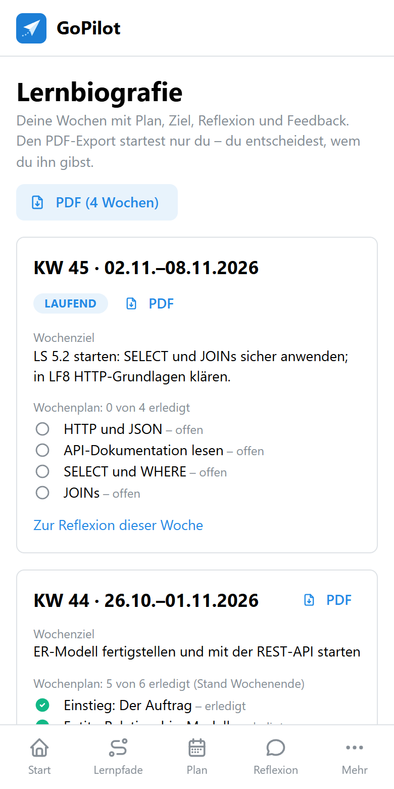

Mit **PDF** exportierst du alle geladenen Wochen oder eine einzelne Woche. Den Export kannst nur du auslösen. Ob du ihn weitergibst, etwa an deinen Ausbildungsbetrieb, entscheidest du selbst.

## Einstellungen

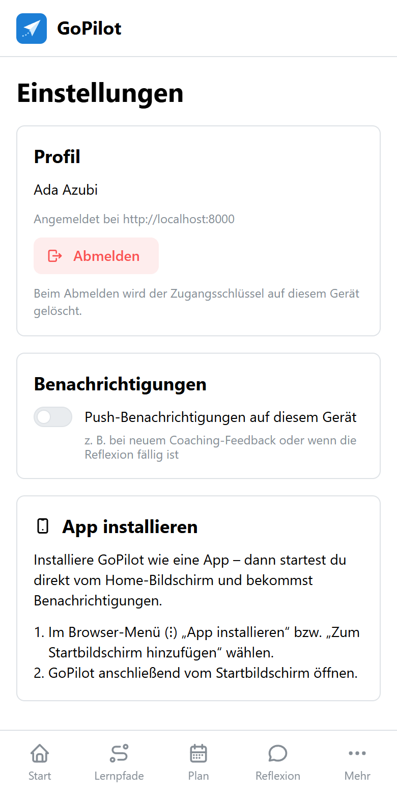

Unter **Mehr → Einstellungen** kannst du:

- dich **abmelden**: Der Zugangsschlüssel wird auf diesem Gerät gelöscht.
- **Push-Benachrichtigungen** für dieses Gerät ein- oder ausschalten.
- GoPilot **als App installieren**: Dann startest du direkt vom Home-Bildschirm. Auf dem iPhone kommen Push-Nachrichten nur an, wenn GoPilot installiert ist (in Safari: Teilen → „Zum Home-Bildschirm“).

---

# Teil B: Für Lehrkräfte

Als Lehrkraft eines Kurses sind Sie dort automatisch **Lerncoach**. Voraussetzung ist, dass der Moodle-Kurs wie in der Anleitung [Moodle-Kurs für GoPilot vorbereiten](lehrkraefte-moodle.md) aufgebaut ist. Am Rechner zeigt GoPilot links eine Seitenleiste mit **Lerndoku** und, wenn Sie den Kurs bearbeiten dürfen, **Kurseinstellungen**.

## Lerndoku

Die Lerndoku zeigt alle Lernenden eines Kurses mit Förder-Ampel, Wochenplan und Wochenziel der laufenden Woche, den vier Signalen, dem Kursfortschritt und der letzten Kursreflexion.

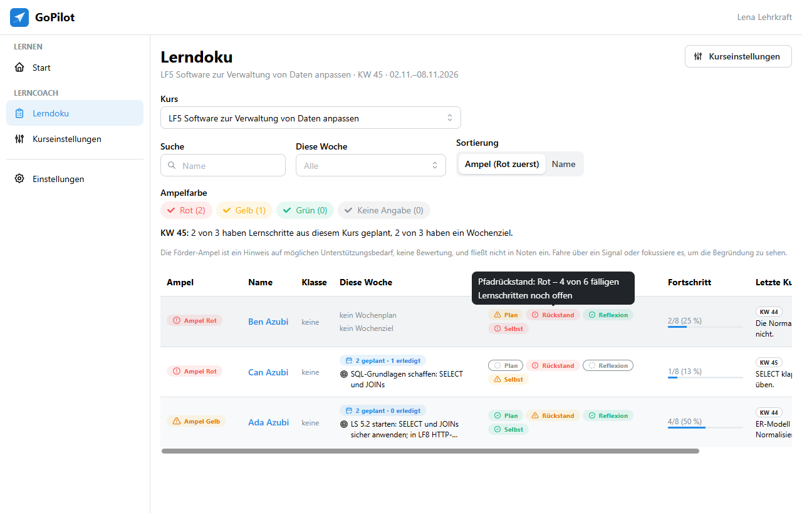

- **Sortierung:** Standardmäßig steht Rot oben, alternativ nach Name.
- **Filter:** Über die Ampelfarben blenden Sie z. B. nur Lernende mit Rot ein. Über **Suche** finden Sie einzelne Namen.
- **Klasse:** Sind die Lernenden in Moodle globalen Gruppen zugeordnet (z. B. ihrer Klasse), zeigt die Spalte **Klasse** diese Gruppen. Über das Auswahlfeld **Klasse** sehen Sie nur die Lernenden einer globalen Gruppe oder mit **Ohne globale Gruppe** alle, die keiner zugeordnet sind.
- **Diese Woche:** Über der Tabelle steht, wie viele Lernende in der laufenden Woche Lernschritte aus Ihrem Kurs geplant und ein Wochenziel gesetzt haben. Die Spalte **Diese Woche** zeigt je Person, wie viele Schritte aus Ihrem Kurs geplant und schon erledigt sind, und das Wochenziel. Über das Auswahlfeld **Diese Woche** sehen Sie z. B. nur Lernende **ohne Plan in diesem Kurs**.
- **Signale:** Fahren Sie mit der Maus über ein Signal, um die Begründung zu sehen, z. B. „Pfadrückstand: Gelb – 3 von 7 fälligen Lernschritten noch offen“. Das Signal **Plan** bewertet die letzte abgeschlossene Woche, nicht die laufende; den Plan der laufenden Woche sehen Sie in der Spalte **Diese Woche**.
- Ein Klick auf den Namen öffnet die Detailansicht.

Die Ampel ist ein Gesprächsanlass, keine Bewertung, und fließt nicht in Noten ein. Lernende sehen nur ihre eigene Ampel.

## Detailansicht einer:eines Lernenden

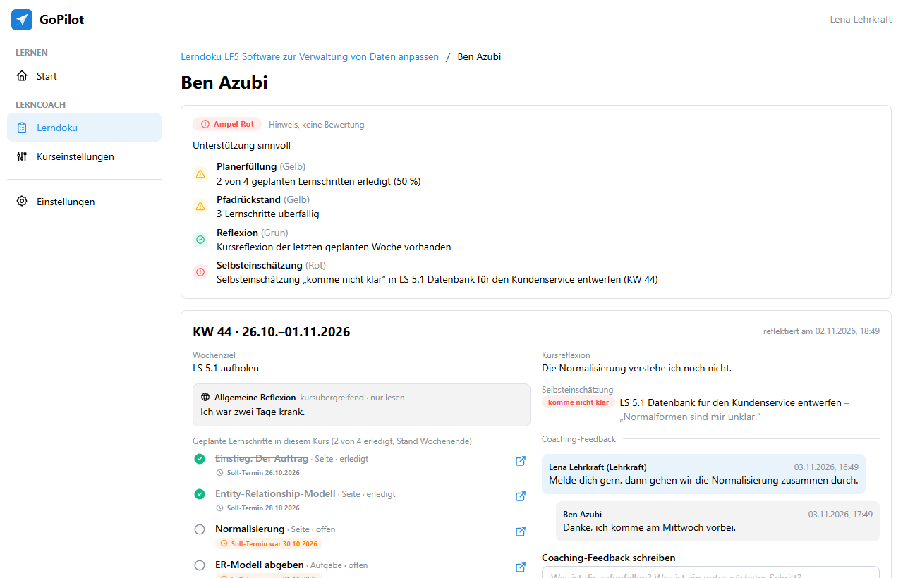

Oben stehen Ampel und Signale, darunter die Wochen, neueste zuerst. Pro Woche sehen Sie:

- **Wochenziel** und **allgemeine Reflexion**: kursübergreifend, nur zum Lesen. Alle Lehrkräfte der:des Lernenden sehen sie.
- die **geplanten Lernschritte dieses Kurses** mit Stand und Soll-Termin.
- **Kursreflexion** und **Selbsteinschätzung** pro Lernpfad.
- den **Coaching-Feedback-Faden**. Unter **Coaching-Feedback schreiben** antworten Sie, die:der Lernende wird benachrichtigt und kann zurückschreiben. Die Nachricht erscheint bei der:dem Lernenden ganz oben auf der Startseite. Unter Ihrer Nachricht steht, ob sie schon gelesen wurde („Gelesen 05.11.2026, 10:30“ oder „Noch nicht gelesen“).

Neue Reflexionen in Ihren Kursen meldet GoPilot Ihnen standardmäßig im Moodle-Benachrichtigungsbereich.

## Portfolios

In der **Lerndoku** eines Kurses öffnet der Knopf **Portfolios** die Übersicht. Oben steht die Tabelle aller Lernenden mit der Zahl ihrer eingereichten, offenen, zu überarbeitenden und abgeschlossenen Einträge. Darunter stehen die Einträge, standardmäßig nur die neu eingereichten.

Unter jedem Eintrag schreiben Sie Ihre **Rückmeldung** und wählen einen **Status**:

- **Rückmeldung geben:** Sie kommentieren, der Eintrag bleibt so.
- **Bitte überarbeiten:** Die:der Lernende kann den Eintrag wieder ändern und erneut einreichen.
- **Abgeschlossen:** Der Eintrag ist fertig. Hier darf die Rückmeldung auch leer sein.

Die:der Lernende wird benachrichtigt. Das Portfolio einer einzelnen Person erreichen Sie über ihren Namen oder in der Detailansicht über **Portfolio**. Entwürfe sehen Sie nicht, nur eingereichte Einträge. Neue Einreichungen meldet GoPilot Ihnen im Moodle-Benachrichtigungsbereich.

## Unterrichtsassistent

Im Menü finden Sie unter **Lerncoach** den Link **Unterrichtsassistent**. Er öffnet den [MMBbS Teaching Assistant](https://github.com/Herr-FR/Gopilot_teaching-assistent) für Tafel und Beamer in einem neuen Tab. Das ist ein eigenes Werkzeug: Seine Daten bleiben im Browser Ihres Geräts und gehen nicht an GoPilot oder Moodle.

Damit Lernende ihren Check-in oder Check-out in GoPilot festhalten, tragen Sie im Teaching Assistant unter **Einstellungen** die Adresse Ihrer GoPilot-App ein. Danach gibt es im Check-in und Check-out den Knopf **GoPilot-QR**. Er zeigt einen QR-Code, der bei den Lernenden einen vorausgefüllten Portfolio-Eintrag öffnet.

Die Links haben diese Form, Sie können sie auch selbst verteilen, zum Beispiel in Moodle:

| Link | öffnet |
|---|---|
| `{app}/portfolio/neu/tagebuch` | Lerntagebuch-Eintrag mit den Check-out-Fragen |
| `{app}/portfolio/neu/strategie?name=Abrufübung` | Eintrag unter Lernstrategien mit dieser Strategie; Strategien aus der gemeinsamen Liste bringen ihre Beschreibung mit |
| `{app}/portfolio/neu/strategie?name=…&text=…` | eigene Strategie mit Beschreibung |
| `{app}/portfolio/neu/{register}?titel=…` | beliebiges Register (`ergebnis`, `reflexion`, `strategie`, `ziel`, `feedback`, `tagebuch`, `nachweis`) mit Titel |

## Kurseinstellungen

Die Kurseinstellungen kann ändern, wer den Kurs in Moodle bearbeiten darf (Rolle Trainer/in).

Unterrichtswochen müssen Sie nicht pflegen. Planerfüllung und fehlende Reflexion richten sich nach den Wochenplänen der Lernenden: Es zählen nur Wochen, in denen jemand Lernschritte Ihres Kurses geplant hat. Ferien und Betriebswochen ohne Plan färben die Ampel deshalb nicht. Wer gar nicht plant, fällt nur über den **Pfadrückstand** auf. Setzen Sie darum in Moodle Soll-Termine für die Lernschritte.

### Schwellwerte

Hier legen Sie fest, ab wann ein Signal gelb oder rot wird. Solange **Standardwerte verwenden** eingeschaltet ist, gelten die Werte aus Teil A. Die Stufen der Selbsteinschätzung sind fest.

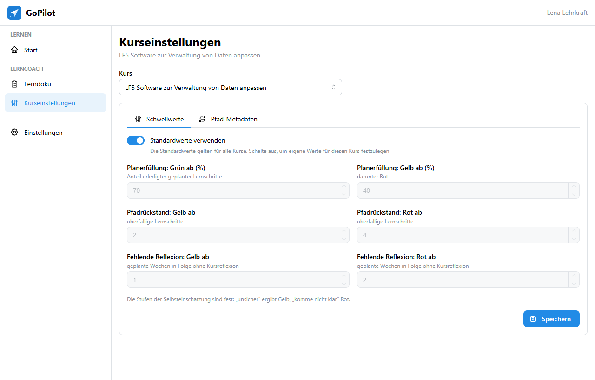

### Pfad-Metadaten

Für jeden Lernpfad und Lernschritt können Sie optional **Phase** (z. B. „Informieren“), **Dauer** in Minuten und **Niveau** angeben. Die Lernenden sehen die Angaben in den Lernpfaden und beim Planen.

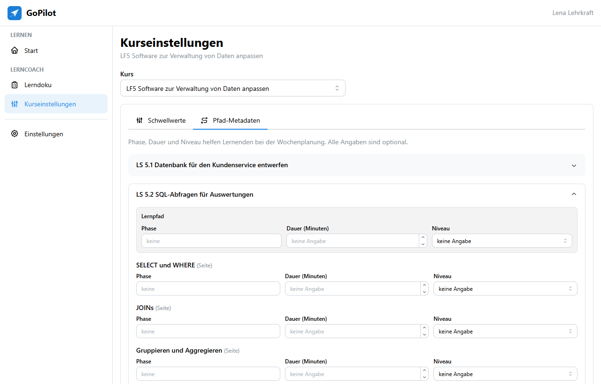

## Häufige Fragen

**Eine Ampel steht auf Rot, obwohl die:der Lernende gut mitarbeitet.**
Schauen Sie auf das auslösende Signal. Oft sind es Soll-Termine, die für die Lerngruppe zu früh liegen, oder Schwellwerte, die nicht zur Lerngruppe passen. Passen Sie die Termine in Moodle oder die Kurseinstellungen an.

**Ein Signal zeigt einen grauen Kreis.**
Es wird gerade nicht ausgewertet, z. B. weil die:der Lernende letzte Woche bzw. noch nie etwas aus diesem Kurs geplant hat.

**Lernende sehen einen Lernschritt nicht.**
GoPilot zeigt nur Aktivitäten, die in Moodle sichtbar und für die Person verfügbar sind. Textfelder und der Abschnitt „Allgemeines“ erscheinen nicht.
